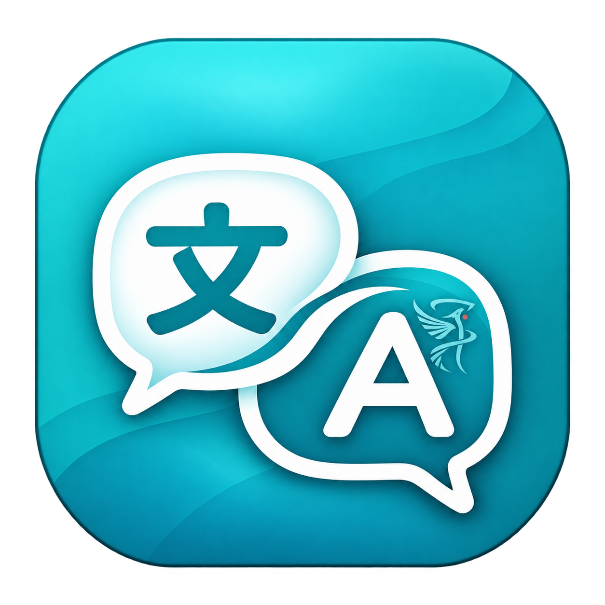

<p align="center"></p>

# SpokenFlow

在 Windows 输入时查看自然、简洁的译文。保留现有输入法，从七种语言中选择两种，输入翻译和划词翻译自动判断方向。

[English](README.en.md) · [使用指南](docs/USAGE.md) · [兼容性](docs/COMPATIBILITY.md) · [参与贡献](CONTRIBUTING.md) · [问题与帮助](SUPPORT.md)

0.1.0-alpha.1 是早期版本，部分兼容性未完成。项目采用禁止商用的源码可见许可，不属于 GPL 或 OSI 开源许可。

## 功能

- 支持中文、英语、法语、德语、俄语、韩语和日语。选择两种语言后，输入和划词共用设置，双向互译。
- 文字确认进入输入框后，短暂停笔即开始流式翻译。已有译文在更新时保留，过期结果不能用于替换。
- 浮窗支持拖动、缩放、长文滚动、透明度和背景颜色。最小化为小图标后暂停请求，展开时翻译最新内容。
- 完整译文可用 `Ctrl+Alt+E` 替换已核对的输入范围，`Ctrl+Alt+Z` 尝试恢复原文。
- 鼠标划词显示可复制的临时译文。标准读取失败时，可用复制选区补救，并尽量恢复剪贴板。

界面也提供这七种语言，首次启动默认英语，之后记住选择。语言列表使用各自的名称，界面语言和互译语言独立设置。短词、专有名词和混合语言可能判断不准，详见[语言设置](docs/LANGUAGES.md)。

## 开始使用

需要 Windows 10/11 x64、.NET Framework 4.8，以及可用的模型服务。目前仅支持 Windows。

1. 从[版本下载页](https://github.com/ShWenjun/SpokenFlow/releases/tag/v0.1.0-alpha.1)下载 Windows 程序包，解压并运行 `SpokenFlow.exe`，或从源码构建。
2. 点击 Check compatibility（检测兼容性），先在练习输入框或无敏感内容的文档中检查读取范围。检测模式不调用 API。
3. 填写服务地址、模型及对应 API Key，选择两种翻译语言，再点击 Save and enable（保存并开启）。
4. 切换到受支持的输入框开始输入。需要划词时，在浮窗中开启划词开关。

这是便携程序，没有安装器，当前未做代码签名。默认连接 DeepSeek，模型预设为 `deepseek-flash`。也可配置兼容 OpenAI Chat Completions 的服务或本机模型接口，详见[模型服务设置](docs/PROVIDERS.md)。模型可用性和费用以服务商为准。

使用在线模型需要自己的 API Key。输入范围和主动划选的文字会在翻译时发送到你设置的服务，请阅读[隐私说明](PRIVACY.md)。不要把密钥或真实聊天内容提交到 Issue。

## 兼容范围

标准 Windows 文本框和 Word 当前段落有本机验证记录。Chrome 新标签页中央搜索框有浮窗与译文的使用验证记录。其他浏览器、Office 和编辑器已有部分适配代码，但尚未逐项验收。

微信和豆包桌面端目前不支持。程序不提供 OCR。输入法和目标软件共同决定能否读取文字，不能据此承诺所有应用可用。各软件的范围与证据见[兼容性矩阵](docs/COMPATIBILITY.md)。

## 从源码构建

在 Windows PowerShell 中进入仓库目录，运行以下命令。

```powershell
.\build.ps1
.\scripts\test.ps1 -NoBuild
.\artifacts\bin\SpokenFlow.exe
```

构建使用 Windows 自带的 .NET Framework C# 编译器，无需 Python、Node.js、NuGet 或 API Key。构建本身不联网。[开发指南](docs/DEVELOPMENT.md)介绍代码结构和调试方式。

```powershell
# 生成本地程序包、源码包及 SHA-256 校验值，不会上传
.\scripts\package.ps1
```

构建流程包含离线自测，覆盖响应解析、结果失效、选区读取、剪贴板保护和语言设置。验证范围与已知缺口见[测试说明](docs/TESTING.md)。

## 参与维护

欢迎提交可复现的兼容性报告、翻译问题、测试改进和范围明确的修复。较大的功能改动请先讨论。维护方向见[路线图](docs/ROADMAP.md)，提交流程见[贡献指南](CONTRIBUTING.md)。

## 许可与品牌

[LICENSE](LICENSE) 允许个人非商业、非商业教学及非商业研究使用，禁止企业内部办公、受雇工作和有偿工作等商业用途。分发修改版时，须向接收者提供对应完整源码并保留非商业限制。具体以完整许可为准。

个人飞鸟标识和软件图标另按[品牌规则](BRANDING.md)保留权利。项目不隶属于 Microsoft、Tencent 或 DeepSeek，也未获得这些公司的背书。
