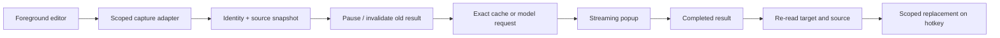

# 开发指南 / Development

## 环境与命令 / Environment and commands

Windows 10/11 x64 + .NET Framework 4.8。从仓库根目录运行：Run from the repository root:

```powershell
.\build.ps1
.\scripts\test.ps1 -NoBuild
.\scripts\check-source.ps1
.\scripts\package.ps1
```

编译器来自 `%WINDIR%\Microsoft.NET\Framework64\v4.0.30319\csc.exe`；不依赖 IDE、NuGet 或 API 密钥。C# 源码须保持与该编译器兼容。Build uses the installed .NET Framework compiler; avoid newer C# syntax it cannot compile.

构建产物位于 `artifacts/`，不应提交 Git。打包脚本按明确文件清单生成程序 ZIP、对应源码 ZIP、SHA-256，不创建或发布 GitHub Release。版本记录在 `VERSION` 和 `source/AssemblyInfo.cs`，发版时保持一致。

Outputs go to ignored `artifacts/`. Packaging uses explicit file lists and creates binary/source archives and checksums locally. Keep VERSION and AssemblyInfo metadata aligned. It does not publish a release.

## 结构 / Structure

| 文件 / File | 职责 / Responsibility |
|---|---|
| `source/App.cs` | 主窗口、轮询、结果失效、缓存、快捷键 / Main UI, polling, invalidation, cache and hotkeys |
| `source/Capture.cs` | UIA 读取、范围身份、替换 / UIA reading, identity and replacement |
| `source/CaptureThread.cs` | STA 消息泵读取线程 / STA capture worker with message pump |
| `source/OfficeCapture.cs` | Word/PowerPoint 原生接口 / Office native-object adapters |
| `source/NativeControls.cs` | Win32 与 Scintilla / Native controls and Scintilla |
| `source/JavaCapture.cs` | Java Access Bridge / Java accessibility adapter |
| `source/Core.cs` | 语言组合、配置、地址验证、DPAPI、Chat Completions SSE / Language pairs, settings, endpoint validation, DPAPI and SSE client |
| `source/Bubble.cs`, `TranslationView.cs`, `Appearance.cs` | 浮窗、滚动和外观 / Popup, scroll and styling |
| `source/Selection.cs`, `SelectionController.cs`, `SelectionClipboard.cs` | 鼠标划词、有限重试、剪贴板补救与临时结果 / Gestures, bounded retries, clipboard fallback and translation |
| `source/Localization.cs`, `Locales.json` | 七种界面语言与内嵌文案 / Seven UI languages and embedded strings |
| `source/SelfTest.cs` | 固定数据离线自测 / Synthetic offline tests |



## 测试边界 / Test boundaries

`--self-test` 只处理固定数据，不启动监控或请求 API。`--demo` 仅为固定例句“我们晚点再聊。我先把手头的事情做完。”提供预设英文；需在界面开启。`--inspect` 启动兼容性检测。`--playground` 创建独立练习窗口。`--bubble-preview` 为不联网外观预览。

Self-tests do not monitor other windows or call the API. Demo mode serves a fixed translation for a fixed example and must be enabled in the UI. Inspection, playground and popup-preview modes support manual testing.

本地测试报告不证明所有应用兼容。UIA、COM 或桥接提供者卡住可能阻塞读取线程；主界面替换路径等待读取的延迟、IME/TSF 组合状态、复杂富文本格式和多窗口竞态仍需改进。Current architecture still needs work on provider hangs, replacement waits, IME/TSF states, rich formatting and multiwindow races.

## 语言设置 / Language configuration

`LanguagePair` 定义七种语言、显示名称、双向提示词与缓存标识。输入和划词共用 `Settings.Pair`，缓存同时包含服务地址、语言组合、模型与原文。切换语言须取消旧任务并清空可替换结果，不能复用上一组的译文。

`LanguagePair` defines supported languages, labels, the bidirectional prompt and cache identity. Typing and selection share `Settings.Pair`. Cache keys include endpoint, pair, model and source; changing the pair must invalidate previous requests and replaceable results. See [test evidence](TESTING.md) for coverage.

## CI

Windows Actions 在 push/PR/manual 时构建并运行离线自测，不读取用户输入，不使用模型服务密钥。权限为 `contents: read`，不自动发布 Release；Actions 固定到具体提交，Dependabot 提议更新。CI 运行结果见仓库 Actions 页面；当前本地候选尚无云端运行记录。

The workflow uses read-only repository permissions and synthetic tests, without API keys or release publishing. Actions are pinned and Dependabot proposes updates. Hosted CI is unverified until its first actual run.
